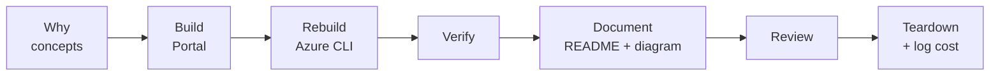

# Azure Fundamentals Lab

> Learning every AZ-900 concept by **building** it — Portal first, then Azure CLI,
> then Infrastructure as Code. No exam: working infrastructure, scripts and diagrams.

## Workflow (every phase)



## Phases

| # | Phase | Covers | Status |
|---|---|---|---|
| 0 | [Setup](phase-0-setup/) | Account, budget, tooling, repo | 🟡 In progress |
| 1 | [Cloud concepts](phase-1-cloud-concepts/) | Service & deployment models, SLAs, regions, management groups | ⬜ |
| 2 | [Networking](phase-2-networking/) | Hub-spoke VNets, NSGs, DNS, private endpoints, App Gateway | ⬜ |
| 3 | [Compute](phase-3-compute/) | VMs, availability, VMSS + LB, App Service, ACI, Functions | ⬜ |
| 4 | [Storage & data](phase-4-storage-data/) | Storage tiers & redundancy, Files, SQL, Cosmos DB | ⬜ |
| 5 | [Identity & security](phase-5-identity-security/) | Entra ID, MFA, RBAC, Conditional Access, Key Vault, Defender | ⬜ |
| 6 | [Governance & monitoring](phase-6-governance-monitoring/) | Policy, locks, Cost Management, Monitor, App Insights | ⬜ |
| 7 | [IaC](phase-7-iac/) | ARM → Bicep → Terraform, one-command deploy/destroy | ⬜ |
| — | [Concepts](concepts/) | One-pagers: databases, integration, IoT, AI/ML, … | ⬜ |

## Repo layout

```
.
├── phase-N-<name>/
│   ├── README.md        # what was built, why, how to verify
│   ├── scripts/         # Azure CLI / PowerShell / IaC used in the phase
│   └── diagrams/        # Excalidraw source + exported PNG/SVG
├── concepts/            # concept-only one-pagers
├── docs/templates/      # README templates
└── cost-log.md          # spend per session
```

## Cost guardrails

- Azure Free account, **$10 monthly budget alert** on the subscription
- Region: **Southeast Asia**; smallest SKUs (B1s VMs), free tiers wherever possible
- **Every resource group is deleted at the end of every session** — see [cost-log.md](cost-log.md)
- Expensive services are built briefly or documented as concept-only

## Tooling

Azure Portal · Azure CLI · Az PowerShell · Bicep · Terraform (Phase 7) · VS Code · Git.
Scripts are tested on **Windows (Git Bash)** and **Ubuntu**.