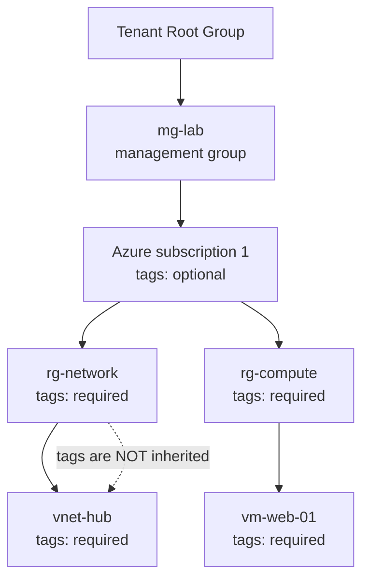

# Naming and tagging standard

> One naming pattern and five required tags for everything this lab creates, so every resource shows what it is, which phase made it and how — and teardown and cost checks are a single query.

## Why
- Most Azure resource names **can't be changed** after creation; renaming means delete and recreate.
- Some names are **global DNS names** (storage, Key Vault, web/function app, SQL, Cosmos DB), so they must be unique across all of Azure.
- **Tags** are `key=value` metadata on subscriptions, resource groups and resources. Azure doesn't act on them; they're for filtering, cost reporting (Cost Management can group by tag) and automation.

## Where names and tags apply



## Naming pattern

`<type>-<workload>[-<nn>]`

| Part | Rule | Example |
|---|---|---|
| `type` | Microsoft CAF abbreviation (table below) | `vm`, `vnet`, `rg` |
| `workload` | short lowercase purpose | `web`, `hub`, `network`, `data` |
| `nn` | two-digit instance, only when there can be more than one | `01` |

- Lowercase only, hyphen as separator.
- **Globally unique names** add the fixed 4-hex lab suffix `LAB_SUFFIX` (generated once with `openssl rand -hex 2`): `kv-lab-<suffix>`, `app-web-<suffix>`.
- **Storage accounts** allow lowercase letters and digits only (≤ 24): `stlab<suffix>`.
- Fixed names: management group `mg-lab`; resource groups `rg-network`, `rg-compute`, `rg-data`, `rg-mgmt`.

### Decisions

| Setting | Choice | Why |
|---|---|---|
| Environment in name | No | One environment (`lab`), carried in the `env` tag |
| Region in name | No | One region (`southeastasia`), already stored in each resource's `location` |
| Case / separator | Lowercase, hyphens | Some types require lowercase; one rule for everything |
| Global suffix | Fixed 4 hex chars | Scripts produce the same names on every rerun |
| Trade-off | — | Organisations with several environments and regions put them in names (`vm-web-prod-sea-001`), because names appear where tags don't (DNS, logs, alerts) |

### Abbreviations (CAF)

| Abbr. | Resource | Example |
|---|---|---|
| `mg` | Management group | `mg-lab` |
| `rg` | Resource group | `rg-network` |
| `vnet` / `snet` | Virtual network / subnet | `vnet-hub`, `snet-web` |
| `nsg` | Network security group | `nsg-web` |
| `nic` / `pip` | Network interface / public IP | `nic-web-01`, `pip-web-01` |
| `vm` / `vmss` | Virtual machine / scale set | `vm-web-01`, `vmss-web` |
| `lb` / `agw` | Load balancer / Application Gateway | `lb-web`, `agw-web` |
| `asp` / `app` / `func` | App Service plan / web app / function app | `asp-web`, `app-web-<suffix>`, `func-api-<suffix>` |
| `ci` | Container instance | `ci-web` |
| `st` | Storage account | `stlab<suffix>` |
| `kv` | Key Vault | `kv-lab-<suffix>` |
| `sql` / `cosmos` | SQL server / Cosmos DB account | `sql-data-<suffix>`, `cosmos-data-<suffix>` |
| `log` / `appi` | Log Analytics / Application Insights | `log-lab`, `appi-web` |

### Name rules for the strict types

| Type | Length | Allowed | Unique within |
|---|---|---|---|
| Resource group | 1–90 | letters, digits, `_ - . ( )`; can't end with `.` | subscription |
| Storage account | 3–24 | lowercase letters + digits | global |
| Key Vault | 3–24 | letters, digits, hyphens; starts with a letter | global |
| Web / function app | 2–60 | letters, digits, hyphens | global (`*.azurewebsites.net`) |
| SQL server | 1–63 | lowercase letters, digits, hyphens | global |
| Cosmos DB account | 3–44 | lowercase letters, digits, hyphens | global |
| VM | Linux 1–64; Windows computer name ≤ 15 | letters, digits, hyphens | resource group |

## Required tags

| Key | Allowed values | Purpose |
|---|---|---|
| `project` | `az900-lab` | Find everything from this lab |
| `phase` | `phase-0` … `phase-7` | Which phase created it; matches the folder prefix and git tags |
| `env` | `lab` | Environment, explicit for cost filtering |
| `owner` | `madushanka` | Who owns it |
| `managedBy` | `portal` · `cli` · `bicep` · `terraform` | How it was created; used for the Phase 7 comparison |

Rules: keys in camelCase, values in lowercase, applied **at creation** to every resource group **and** every resource. No secrets in tags — they're plain text visible to anyone with read access.

## How it's applied and checked

| File | What it does |
|---|---|
| `scripts/lab-standards.sh` | Shared values + `lab_tags <phase-N> [managedBy]` (validates both). Sourced by every phase |
| `phase-1-cloud-concepts/scripts/check-tags.sh` | Lists resource groups (or `--resources`) with missing or wrong tags; exit code 1 on failure |

```bash
source "$(git rev-parse --show-toplevel)/scripts/lab-standards.sh"
tags=$(lab_tags phase-1 cli) || exit 1
mapfile -t TAGS <<< "$tags"
az group create -n rg-network -l "$LAB_LOCATION" --tags "${TAGS[@]}"
```

Enforcement comes in Phase 6: Azure Policy to **require** tags and **inherit** them from the resource group.

## Verify

```bash
bash phase-1-cloud-concepts/scripts/check-tags.sh               # [OK]
bash phase-1-cloud-concepts/scripts/check-tags.sh --resources
az group list --tag project=az900-lab -o table
az tag list --query "[].tagName" -o tsv
```

## Gotchas
- **Tags are not inherited.** A tagged resource group doesn't tag its resources; tag both, or use Policy (Phase 6).
- **`az group update --tags` / `az resource update --tags` replace the whole tag set.** To add or change one tag: `az tag update --resource-id <id> --operation Merge --tags k=v`.
- **`--tags` with no values creates an untagged resource** — that's why scripts use `tags=$(lab_tags …) || exit 1` instead of `mapfile < <(lab_tags …)`, which hides errors.
- **Tag keys are case-insensitive, values are case-sensitive.** `env=Lab` and `env=lab` are separate values in cost reports. `check-tags.sh` is case-sensitive for both.
- **Cost data shows tags only from when they're applied**, not retroactively, and lags 8–24 h. Resource groups cost nothing, so a tag appears in Cost analysis → Group by → Tag only once a tagged billable resource exists.
- **Limits:** 50 tags per resource / resource group / subscription; key ≤ 512 chars (≤ 128 on storage accounts); value ≤ 256; keys can't contain `< > % & \ ? /`.
- Not every resource type supports tags. Azure-created groups (`NetworkWatcherRG`, `DefaultResourceGroup-*`) are skipped by the checker.
- **Key Vault soft delete** reserves a deleted vault's name for up to 90 days → `az keyvault purge -n <name>` or bump `-nn`. Don't enable purge protection in the lab.
- **Git Bash rewrites arguments starting with `/`** (resource IDs) into Windows paths → prefix with `MSYS_NO_PATHCONV=1`.