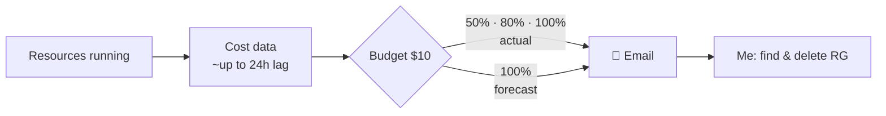
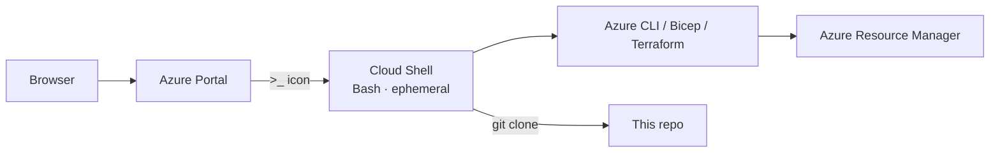
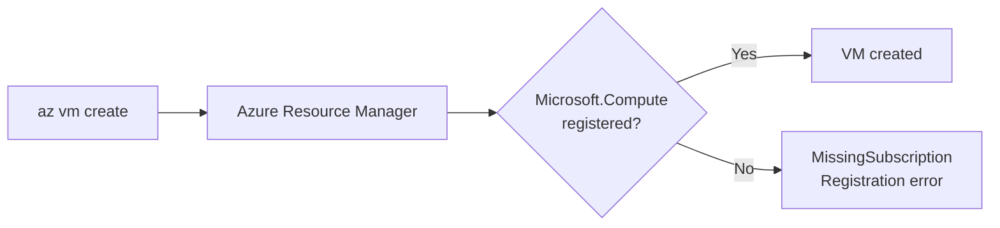

# Phase 0 — Setup

> Everything later phases depend on: a cost safety net, tooling that works on
> Windows and Ubuntu, and a repo structure reused by every phase.

## Contents

| # | Step | Built with |
|---|---|---|
| 1 | Budget alert | Portal |
| 2 | GitHub repository | Git + GitHub |
| 3 | Portal tour & Cloud Shell | Portal |
| 4 | Resource providers | Portal + CLI |
| 5 | Local tooling | winget / apt |

---

## 1. Budget alert

> A budget **notifies**, it doesn't **stop**. The Free Trial spending limit is
> the real cap; this $10 budget is an early warning for forgotten resources.

| Setting | Value | Why |
|---|---|---|
| Scope | Subscription | Catches every resource group |
| Amount / reset | $10 / monthly | Anything above = something left running |
| Alerts | Actual 50/80/100%, Forecast 100% | Forecast warns *before* overspend |
| Action group | None | Email is enough; action groups in Phase 6 |

**Verify:** Cost Management → Budgets → `budget-lab-monthly` shows $0 / $10.

**Gotchas**
- Alerts lag up to a day → deleting RGs after every session is the real control.
- "Email required" errors appear on every row until *Alert recipients* is filled.

---

## 2. GitHub repository

> One repo, one folder per phase. Every phase ships a README, scripts and a
> diagram — and everything runs the same on Windows (Git Bash) and Ubuntu.

| Decision | Value | Why |
|---|---|---|
| Line endings | `.gitattributes` → LF, added before any other file | Scripts written on Windows run on Ubuntu / Cloud Shell |
| Secrets | `.gitignore` blocks `.env`, keys, `*.tfstate`, `local.settings.json` | Nothing sensitive reaches a public repo |
| Commit email | GitHub `noreply` address | Personal email stays out of public history |
| Commit style | Conventional Commits (`docs(phase-0): …`) | Readable, filterable history |
| Terminal | Git Bash as VS Code default | Same bash commands on Windows and Ubuntu |

**Verify:** `git ls-files --eol` shows `i/lf` for every text file; the repo on GitHub shows all phase folders.

**Gotchas**
- Without `.gitattributes`, Windows Git saves CRLF and Linux fails with
  `/bin/bash^M: bad interpreter`.
- Git doesn't track empty folders → `.gitkeep` placeholders.
- VS Code's integrated terminal defaults to PowerShell on Windows — bash loops fail there.

---

## 3. Portal tour & Cloud Shell

> Cloud Shell is a browser terminal that's already signed in to Azure, with
> Azure CLI, Az PowerShell, Terraform and Git preinstalled — zero setup,
> any device.

| Setting | Value | Why |
|---|---|---|
| Shell | Bash | Same commands as Git Bash and Ubuntu |
| Storage | None (ephemeral session) | No storage account cost; scripts live in GitHub |
| Subscription | Azure subscription 1 | The only lab subscription |

**Verify:** `az account show -o table` shows the subscription as default.

**Gotchas**
- Ephemeral sessions are wiped after ~20 min idle → commit and push often, re-clone when needed.
- Bicep isn't preinstalled → `az bicep install`, and again in every new ephemeral session.
- Portal's *Directories + subscriptions* filter can hide resources — check it first if something "disappears".

---

## 4. Resource providers

> Every Azure service comes from a resource provider (e.g. `Microsoft.Compute`).
> A subscription must be **registered** with a provider before it can create
> that provider's resources. Only the providers this lab uses are registered.

| Decision | Value | Why |
|---|---|---|
| Scope | Subscription | Providers are registered per subscription |
| Which | Only providers used in Phases 1–6 | Least privilege — smaller surface than "register all" |
| How | [`scripts/register-providers.sh`](scripts/register-providers.sh) | Idempotent, re-runnable, documents the list |
| Manual | `Microsoft.Network` via Portal | See the Portal flow once |

**Verify:** `./scripts/register-providers.sh --status` → every provider `Registered`.

**Gotchas**
- The Portal auto-registers on *Create*; CLI / Bicep often don't → register before scripting.
- Registration is async (1–5 min) — `register` returns before it's done.
- `az` on Windows ends output with `\r` → `tr -d '\r'` keeps string comparisons portable.
- Windows has no execute bit → `git update-index --chmod=+x` so `./script.sh` works on Linux.

---

## 5. Local tooling

> Cloud Shell is for quick checks; real work happens locally — persistent files,
> VS Code, and the same tools a CI/CD pipeline would use.

| Tool | Windows | Ubuntu | Used for |
|---|---|---|---|
| Azure CLI | `winget install Microsoft.AzureCLI` | `curl -sL https://aka.ms/InstallAzureCLIDeb \| sudo bash` | Main scripting tool, every phase |
| Bicep | `az bicep install` | `az bicep install` | Azure-native IaC (Phase 7) |
| PowerShell 7 | `winget install Microsoft.PowerShell` | `sudo snap install powershell --classic` | CLI vs PowerShell comparison |
| Az module | `Install-Module Az -Scope CurrentUser` | same (in `pwsh`) | Azure cmdlets |
| VS Code extensions | [`.vscode/extensions.json`](../.vscode/extensions.json) | same | CLI/Bicep IntelliSense, Mermaid, Excalidraw |

| Setting | Value | Why |
|---|---|---|
| `az config defaults.location` | `southeastasia` | Enforces the lab region when `--location` is forgotten |
| Az module scope | CurrentUser | No admin rights, no system-wide changes |
| Terraform | Deferred to Phase 7 | Save disk until needed |

**Verify:** `./phase-0-setup/scripts/register-providers.sh --status` from Git Bash → all `Registered`
(same result as Cloud Shell — the toolchain and the `\r` fix both work).

**Gotchas**
- After installing with winget, **close every terminal and VS Code** — open shells keep the old PATH.
- `pwsh` (PowerShell 7) and `powershell` (5.1) are separate programs; Az module goes in 7.
- The Az module is large (~1 GB) — check free disk first.