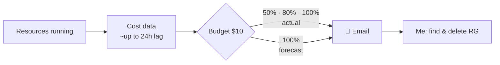

# Phase 0 — Setup

> Everything later phases depend on: a cost safety net, tooling that works on
> Windows and Ubuntu, and a repo structure reused by every phase.

## Contents

| # | Step | Built with |
|---|---|---|
| 1 | Budget alert | Portal |
| 2 | GitHub repository | Git + GitHub |
| 3 | Resource providers | Portal + CLI |
| 4 | Portal tour & Cloud Shell | Portal |
| 5 | Local tooling | winget / apt |

---

## 1. Budget alert

> A budget **notifies**, it doesn't **stop**. The Free Trial spending limit is
> the real cap; this $10 budget is an early warning for forgotten resources.

| Setting | Value | Why |
|---|---|---|
| Scope | Subscription | Catches every resource group |
| Amount / reset | $10 / monthly | Anything above = something left running |
| Alerts | Actual 50/80/100%, Forecast 100% | Forecast warns *before* overspend |
| Action group | None | Email is enough; action groups in Phase 6 |

**Verify:** Cost Management → Budgets → `budget-lab-monthly` shows $0 / $10.

**Gotchas**
- Alerts lag up to a day → deleting RGs after every session is the real control.
- "Email required" errors appear on every row until *Alert recipients* is filled.

---

## 2. GitHub repository

> One repo, one folder per phase. Every phase ships a README, scripts and a
> diagram — and everything runs the same on Windows (Git Bash) and Ubuntu.

| Decision | Value | Why |
|---|---|---|
| Line endings | `.gitattributes` → LF, added before any other file | Scripts written on Windows run on Ubuntu / Cloud Shell |
| Secrets | `.gitignore` blocks `.env`, keys, `*.tfstate`, `local.settings.json` | Nothing sensitive reaches a public repo |
| Commit email | GitHub `noreply` address | Personal email stays out of public history |
| Commit style | Conventional Commits (`docs(phase-0): …`) | Readable, filterable history |
| Terminal | Git Bash as VS Code default | Same bash commands on Windows and Ubuntu |

**Verify:** `git ls-files --eol` shows `i/lf` for every text file; the repo on GitHub shows all phase folders.

**Gotchas**
- Without `.gitattributes`, Windows Git saves CRLF and Linux fails with
  `/bin/bash^M: bad interpreter`.
- Git doesn't track empty folders → `.gitkeep` placeholders.
- VS Code's integrated terminal defaults to PowerShell on Windows — bash loops fail there.

---

## 3. Resource providers

_Coming next._

## 4. Portal tour & Cloud Shell

_Coming next._

## 5. Local tooling

_Coming next._